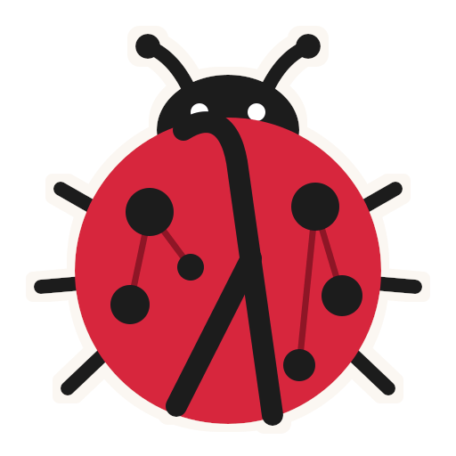

<p align="center"></p>

# Marien

Marien is a LadybugDB extension, written in Lean 4, that stores λProlog (LeanElpi) programs in the database, types them against the graph's schema, and runs them from Cypher to query and validate the graph.

```cypher
LOAD EXTENSION './libmarien.lbug_extension';
CALL elpi_init();
CALL elpi_save('org', 'pred violation o:severity, o:string, o:subject.
  violation error "no-manager" (subj_person P) :- person.name P _, not (reports_to P _ _).');
CALL elpi_validate(['org']) RETURN severity, code, subject_label, subject_pk;
```

- **Site and downloads:** https://volland.github.io/marien/
- **Releases:** https://github.com/Volland/marien/releases. Each release has one zip per OS and CPU, built for one LadybugDB version.
- **Design and decisions:** [`tg.md/`](tg.md/), with the specs in [`openspec/`](openspec/).

The name comes from *Marienkäfer*, German for ladybug.
