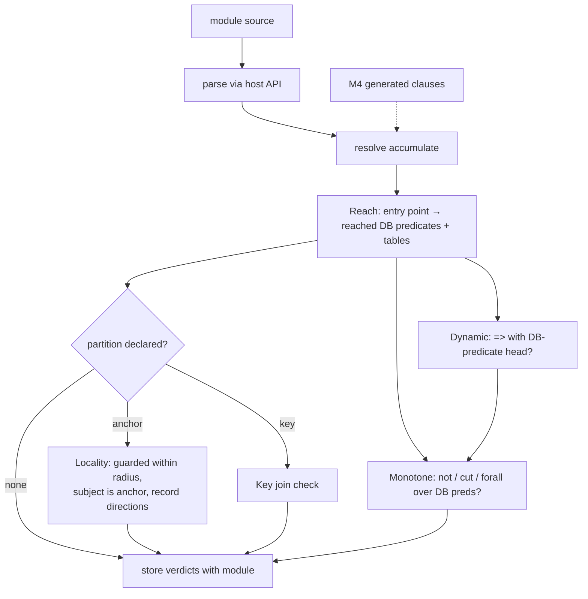
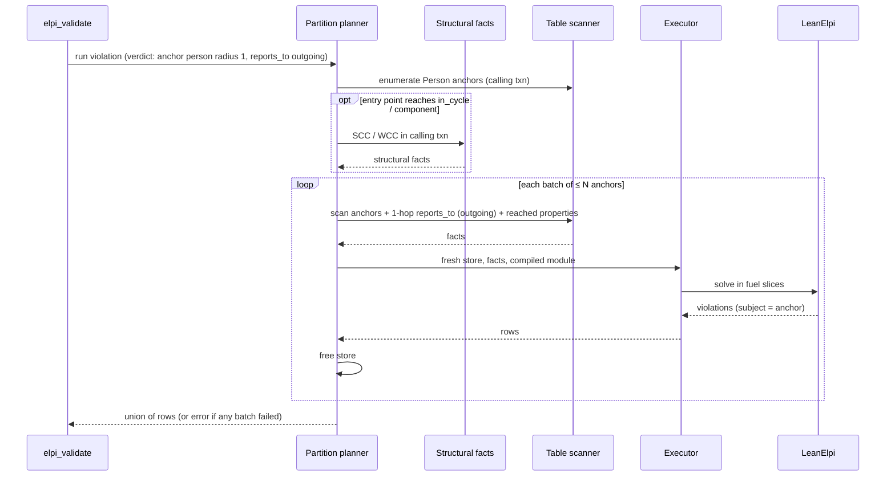
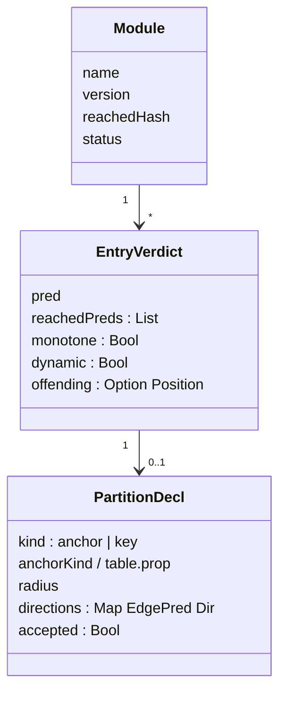

## Context

After M2 every run is full scope: the [[components#Table scanner]] reads every reached table into one LeanElpi store. That is correct by construction ([[decisions#Closed-world scope]]) but does not reach the target of 1M to 100M facts ([[constraints#Target scale is 1M to 100M facts]]), and LeanElpi's memory grows within a long run ([[constraints#LeanElpi memory grows in long runs]]). Reading less data is only safe when a static analysis proves it cannot change the answer. This change adds those analyses, the execution modes that rely on them, and property tests that check the analyses against what they claim.

## Goals / Non-Goals

**Goals:** per-entry-point reachability, monotonicity, `dynamic` and locality verdicts stored with each module; narrowed scope for monotone entry points; anchor partitions, key partitions and structural facts; differential property tests 1 to 3 of [[decisions#Differential testing with an oracle]].

**Non-Goals:** incremental maintenance between calls; partitioning dynamic entry points; the Soufflé oracle (M5); proofs of analysis soundness as a release gate (stretch goals below).

## Decisions

### Analyses run on the clause AST at save time and on recheck
The [[components#Rule analyzer]] works on the parsed clause AST exposed by M0's host API, after `accumulate` is resolved. Verdicts are stored with the module and recomputed whenever M2's recheck regenerates the module, so they always match the compiled code. M4's generated clauses enter the same pipeline.
- Motivated by [[decisions#Closed-world scope]] ([[adr:0009]]) and [[decisions#Staged rule generation over a reflected schema]] ([[adr:0010]]).
- Rejected: analysing at run time (adds latency to every call and hides rejections until production); analysing source text (misses `accumulate` and macros).

### Monotonicity is syntactic and conservative
An entry point is monotone when no reachable `not`, cut or `forall` can reach a database predicate, and it is not `dynamic`. Variable predicates are over-approximated by type. This rejects some safe programs (cut used only for efficiency), and the rejection measure in the test harness tracks how many.
- Records part of [[decisions#Closed-world scope]].
- Rejected: semantic analysis with abstract interpretation (much larger, harder to trust, and the property tests would have to check it anyway).

### `dynamic` is inferred and cannot be cleared
A `=>` that adds a clause with a database predicate head makes an entry point `dynamic`. A user may add the mark, never remove it.
- Records part of [[decisions#Staged rule generation over a reflected schema]].
- Rejected: trusting a user annotation (a wrong one silently brings back false answers).

### Locality as guarded atoms within a radius
A declared anchor partition is accepted when every reachable database atom is linked to the anchor variable through at most `radius` edge atoms, and the violation subject is the anchor itself, so overlapping neighbourhoods cannot double-count. The check records traversal directions, so the scanner reads only what the rules can see.
- Records [[decisions#Partitioned validation]] ([[adr:0016]]).
- Rejected: user-supplied partition queries without a check (fast and silently wrong); partition by connected component only (one giant component defeats it).

### Scan neighbourhoods and structural facts in the calling transaction
The [[components#Partition planner]] enumerates anchors and asks the [[components#Table scanner]] to read each batch's neighbourhood through the graph API in the calling transaction. [[components#Structural facts]] compute SCC and WCC in the same transaction by calling the algo extension's component routines from C++ (or an equivalent routine over the scanned edges when the algo extension is not loaded), never through a nested query. Facts are therefore never stale and never re-enter the database.
- Records [[decisions#Scan tables in the calling transaction]] ([[adr:0021]]).
- Rejected: a precomputed table of cycle facts (stale after any edge change); running `CALL scc(...)` as a nested query (re-entrancy).

### Fresh store per batch
Each batch gets a new store and compiled program instance; nothing carries over except output rows. This also bounds the memory growth of long LeanElpi runs.
- Motivated by [[constraints#LeanElpi memory grows in long runs]].

### Narrowed scope is a key list applied by the scanner
A scope is a map from node table to primary keys, applied while scanning; edges are loaded only when their restricted endpoints are listed. Only monotone entry points accept one, and their rows carry `narrowed = true`.
- Records part of [[decisions#Closed-world scope]].
- Rejected: Cypher subqueries as scopes (nested queries from inside a call).

## Diagrams

Analysis pipeline at save time and on recheck:

Partitioned validation of one entry point:

Module data model added by this change:

## Proofs and tests

Per [[decisions#Proofs where practical]] ([[adr:0020]]):

| Property | How | Why |
|---|---|---|
| The partition planner covers every anchor exactly once | proved: `Marien.Partition.batches_partition` (the batches are pairwise disjoint and their union is the anchor set) | finite lists, total statement |
| Each violation is emitted by exactly one batch when its subject is the anchor | proved: `Marien.Partition.violation_unique_batch`, from `batches_partition` and the subject-is-anchor condition | follows from disjointness |
| Key buckets cover every non-null row exactly once and rows with equal keys share a bucket | proved: `Marien.Partition.key_buckets_sound` | finite, hash is a function |
| Reachability over-approximates calls | proved: `Marien.Analysis.reach_closed` (the reached set is closed under the call relation of the AST) | fixpoint over a finite graph |
| Monotonicity soundness: a monotone entry point's answers on a sub-database are a subset of its answers on the database | stretch theorem `Marien.Analysis.monotone_sound` over an abstract finite Horn-with-negation semantics (optional task); guarded in v1 by the narrowing subset property | needs a formal semantics of the analysed fragment |
| Locality soundness: for an accepted partition, answers with subject `a` on `a`'s neighbourhood equal those on the full database | stretch theorem `Marien.Analysis.locality_sound` (optional task); guarded in v1 by the partition equivalence property | same semantics plus a neighbourhood model |
| Analyses agree with execution on real programs | tested: differential properties in `tests/Property/` | crosses the engine and the C++ scanner |

## Risks / Trade-offs

- [Risk] The algo extension's component routines may not be callable from another extension's C++ code. → Fall back to Marien's own SCC (Tarjan) and WCC (union-find) over edges scanned in the calling transaction; the facts are the same.
- [Risk] High-degree anchors make some neighbourhoods huge. → `elpi_max_facts` applies per batch; the planner splits a batch whose scanned size exceeds the cap, down to one anchor, and fails loudly if one anchor alone exceeds it.
- [Trade-off] Conservative monotonicity rejects safe uses of cut. → The rejection-counterexample measure shows how often; refine the analysis when it matters.
- [Risk] Over-approximating variable predicates by type can make reachability, and so full-scope loads, large. → Report the reached set in `elpi_signature` output so users can see why.
- [Trade-off] Dynamic entry points stay full scope and are effectively unusable for validation at 100M facts; this was accepted in the design interview.
