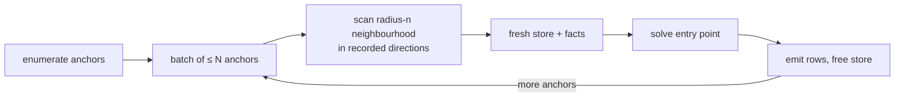

## ADDED Requirements

### Requirement: Anchor partitions
A module SHALL declare an anchor partition with `% @marien partition <pred> by <kind> radius <n>`. When the locality check accepts it, running that entry point (directly or through `elpi_validate`) SHALL: enumerate the anchors of `<kind>` in the calling transaction; split them into batches of at most `elpi_partition_batch` anchors (default 10000); for each batch scan, through the graph API in the calling transaction, the anchors and every node and edge reachable within `<n>` hops along the recorded edge predicates and directions, together with the reached properties; load those facts into a fresh store with the compiled module; solve; and release the store before the next batch. Rows from all batches SHALL be returned as one result. Execution limits SHALL apply per batch, and exhausting any of them in any batch SHALL fail the whole call.

#### Scenario: Partitioned result equals full scope
- **WHEN** an accepted `by person radius 1` partition validates a graph of 50000 persons with batch size 10000
- **THEN** five batches run and the rows equal, as a multiset, the rows of the same entry point at full scope

#### Scenario: Each batch gets a fresh store
- **WHEN** a partitioned run processes several batches
- **THEN** facts loaded for one batch are not visible to the next

#### Scenario: A failing batch fails the call
- **WHEN** the third batch runs out of fuel
- **THEN** the call fails and returns no rows from the first two batches

### Requirement: Key partitions
A module SHALL declare a key partition with `% @marien partition <pred> by <table>.<prop>` for rules that compare rows sharing a property value, such as uniqueness and functional dependencies. The partition SHALL be accepted only when every database atom reachable from the entry point is joined to the partition property through the same value variable. Running it SHALL group rows of `<table>` by a hash of `<prop>` into buckets of bounded size, scan each bucket's rows and the atoms joined to them, solve each bucket in a fresh store, and return the union of rows. Rows whose property is null SHALL form no bucket.

#### Scenario: Duplicate emails are found across buckets
- **WHEN** `violation error "dup-email" (subj_person P) :- person.email P E, person.email Q E, not (P = Q).` declares `by person.email` over 1M persons
- **THEN** the rows equal those of the full-scope run

#### Scenario: Unjoined atom rejects the key partition
- **WHEN** the rule also reads `dept.name D _` with `D` unrelated to the email value
- **THEN** the key partition is rejected at save time

### Requirement: Structural facts
For every rel table whose FROM and TO kinds are the same kind `<kind>`, the signature generator SHALL emit `pred in_cycle.<rel> o:<kind>.` and `pred component.<rel> o:<kind>, o:int.` When an entry point reaches one of them, the extension SHALL compute strongly connected components (for `in_cycle`, a node is in a cycle when its component has more than one node or it has a self-edge) or weakly connected components (for `component`) with LadybugDB's algo extension in the calling transaction before solving, and load the results as facts. Structural facts SHALL never be cached across calls. A component identifier MAY serve as a key partition (`by component.<rel>`).

#### Scenario: Cycles come from SCC
- **WHEN** `reports_to` forms the cycle 1 → 2 → 3 → 1 and an entry point reaches `in_cycle.reports_to`
- **THEN** facts `in_cycle.reports_to (person 1)`, `(person 2)` and `(person 3)` are loaded and no other person is

#### Scenario: Structural facts are never stale
- **WHEN** the edge 3 → 1 is deleted in the calling transaction before the call
- **THEN** no `in_cycle.reports_to` fact is loaded

### Requirement: Dynamic entry points stay whole
A dynamic or otherwise non-monotone entry point whose declared partition was rejected SHALL run at full scope. A dynamic entry point SHALL never be partitioned, and a partition declaration on it SHALL be rejected at save time with an error naming the `=>` goal that made it dynamic.

#### Scenario: Partition on a dynamic entry point is rejected
- **WHEN** a module declares `partition violation by person radius 1` and `violation` is dynamic
- **THEN** `elpi_save` fails with an error naming the `=>` goal
