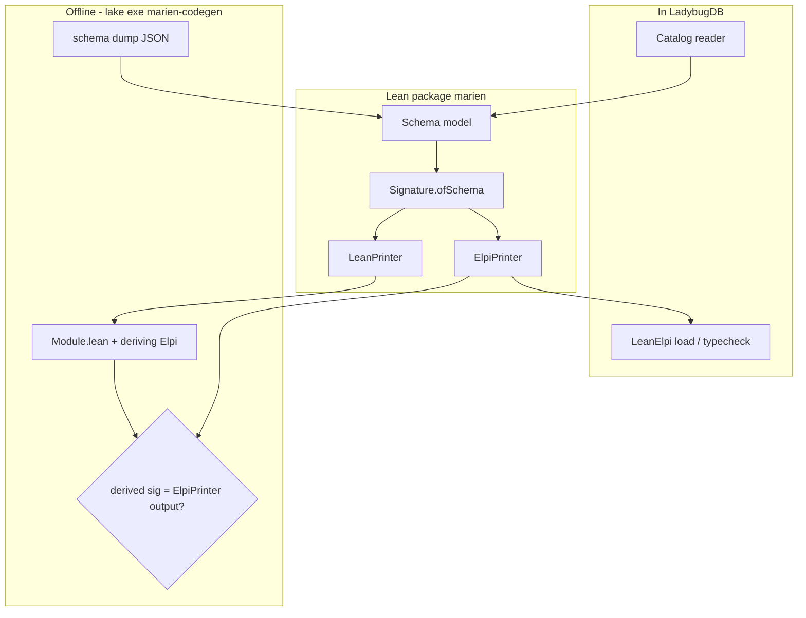
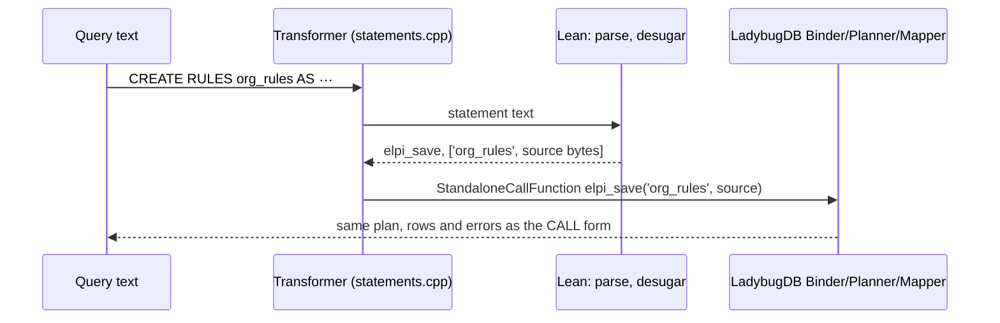

## Context

M1 to M4 deliver the extension itself. M5 adds the parts outside it that earlier decisions promised: offline Lean types for proofs ([[decisions#Schema types at runtime and Lean inductives offline]]), an independent oracle for the static analyses ([[decisions#Differential testing with an oracle]]), statement syntax ([[decisions#CALL functions first]]), and the upstream steps deferred by [[decisions#Lazy recheck by schema hash]] and [[decisions#Out-of-tree extension with its own repository]].

## Goals / Non-Goals

**Goals:** one encoding with two printers, checked to agree; an oracle that shares no code with Marien's engine or analysis; statements with no logic of their own; upstream proposals written and submitted.

**Non-Goals:** running Lean's elaborator inside the database; translating higher-order λProlog to Datalog; statements that behave differently from their `CALL` forms; depending on upstream accepting the proposals.

## Decisions

### One encoding, two printers

`Signature.ofSchema : SchemaModel → Signature` (M1) stays the only definition of the encoding. M5 splits printing out behind a `SignaturePrinter` interface with two instances: `ElpiPrinter`, already used in the database, and `LeanPrinter`, new, which emits `inductive … deriving Elpi`. The [[components#Offline codegen]] reads a canonical schema dump, calls the same `Signature.ofSchema`, and prints with `LeanPrinter`. After emitting, it elaborates the module, reads the ELPI signature that `deriving Elpi` produced, and compares it with `ElpiPrinter`'s output.

- motivated_by:: [[decisions#Schema types at runtime and Lean inductives offline]] {weight: primary}
- motivated_by:: [[decisions#Logic in Lean behind a thin C++ shim]]

**Rejected alternatives:** *a second encoder in the codegen tool* (two implementations that must agree is exactly what the decision rules out); *codegen from the runtime ELPI signature text* (it would parse ELPI text back into Lean structure, a lossy round trip).

### Soufflé as the oracle, restricted to the fragment where semantics coincide

Over finite ground facts, stratified Datalog negation and λProlog negation as failure give the same answers for first-order, cut-free, stratified programs. The translator accepts exactly that fragment and **skips** everything else, so it never compares approximate translations. Skips are counted so that coverage is visible. The oracle runs at full scope, narrowed scope and partitioned, which makes it an independent check of the monotonicity and locality analyses from M3. M3's "Partition equivalence property" and "Narrowing subset property" compare Marien with itself; this one compares Marien with an engine that shares no code with it.

- motivated_by:: [[decisions#Differential testing with an oracle]] {weight: primary}
- motivated_by:: [[decisions#Partitioned validation]]

**Rejected alternatives:** *a Cypher oracle* (translating rules to Cypher is not systematic, and NAF over Cypher patterns is hard to state); *upstream OCaml ELPI as the oracle* (it shares the language semantics but not the database encoding or partitioning; useful for LeanElpi, not for Marien's analyses).

### Statements desugar in the transformer

The [[components#Statement extension]] reads a statement with its own small grammar (Lean, `Marien/Statement.lean`) and the transformer returns the parse tree LadybugDB's parser builds for the statement's `CALL elpi_*` form, with the arguments as literal values. LadybugDB's own Binder, Planner and Mapper then run the `CALL` unchanged, write statements through the same `rewriteFunc`. No statement logic exists outside the desugaring, so equivalence holds by construction and the paired tests confirm it.

- motivated_by:: [[decisions#CALL functions first]] {weight: primary}
- motivated_by:: [[constraints#Extensions are C++ shared libraries]]

**Why not the binder.** A binder extension receives no binder or client context, so it cannot bind the `CALL` it would desugar to; and LadybugDB does not export the vtable of `ParsedFunctionExpression`, so the transformer copies one parsed by LadybugDB's exported parser from `CALL <fn>()` and adds the literal arguments.

**Not reachable yet.** LadybugDB 0.22.1 hands extension transformers only `CREATE USER` and `CREATE ROLE` ([[constraints#Only CREATE USER and CREATE ROLE reach extension parsers]]). The transformer is registered and leaves other text alone; `CALL elpi_statement('<statement>')` runs the same parser and desugaring through the bind of the `CALL` form until LadybugDB accepts a route for extension statements (task 4.5).

### Upstream proposals are tasks, not requirements

A catalog-change hook in LadybugDB, and contributing to `ladybugdb/extensions` with a prebuilt Lean archive, depend on decisions this project does not own. They are tracked as tasks. Nothing in Marien's specs relies on them being accepted.

- motivated_by:: [[constraints#No DDL hooks for extensions]]
- motivated_by:: [[decisions#Out-of-tree extension with its own repository]]

## Proofs and tests

Under [[decisions#Proofs where practical]] ([[adr:0020]]):

| Property | How | Why |
|---|---|---|
| Offline and runtime signatures come from one encoding | **By construction**: both call `Signature.ofSchema` | The structure makes it true; the agreement check guards the printers. |
| `LeanPrinter` and `deriving Elpi` produce the `ElpiPrinter` signature | **Proved where practical**: `LeanPrinter.derive_eq_elpi` for the kind/constructor skeleton; **tested** by property test over random schemas for the full output | `deriving Elpi` runs in `MetaM`, outside what a pure proof can see; the printer-level lemma covers the pure part. |
| Schema dump is canonical | **Proved**: `Dump.canonical_perm` (permuted catalog gives an equal document) | It follows from sorting. |
| Statement desugaring is total and unique | **Proved**: `Statement.desugar_total` (every parsed statement maps to exactly one `CALL` form, of one of the five functions) | A small finite datatype; cheap to prove. |
| Statements equal their `CALL` forms at run time | **Tested**: paired execution on random databases | Depends on LadybugDB's planner. |
| `$$` source reaches the store unchanged | **Proved**: `Statement.source_roundtrip` for the delimiter lexer; **tested** end to end | The lexer is pure; the store path is covered by M1's round-trip test. |
| Locality check soundness (open question) | **Optional**: complete M3's stretch theorem `Locality.sound`, or record the decision to rely on the M3 properties and the Soufflé oracle | This closes the open item from the design interview. |

## Constraints

- [[constraints#Extensions are C++ shared libraries]]: binds the statement extension (built against the pinned LadybugDB version) and the upstream contribution.
- [[constraints#No DDL hooks for extensions]]: binds the eager-recheck proposal.
- [[constraints#Clause type variables are rigid]]: unchanged; `LeanPrinter` must produce types that `deriving Elpi` maps to the same monomorphic kinds.

## Risks / Trade-offs

- **Parser extensions follow LadybugDB internals.** The statement extension is the part most likely to break on a LadybugDB upgrade. The `CALL` forms stay the stable interface, and CI runs the equivalence tests for every pinned version.
- **Oracle coverage is partial.** Higher-order modules never reach Soufflé, so their correctness rests on M3's self-comparison properties. The skip count makes this visible.
- **Soufflé in CI.** It adds a native dependency to the test matrix; the oracle job is separate and required only on Linux.
