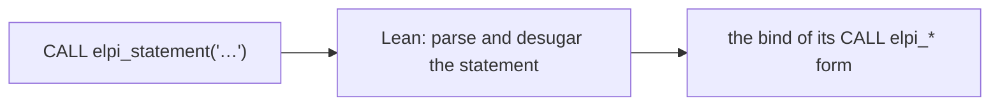

## ADDED Requirements

### Requirement: Rule statements
The extension SHALL provide `CALL elpi_statement('<statement>')`, a table function that takes one statement as a string and accepts:
- `CREATE [OR REPLACE] RULES <name> AS $$<source>$$`
- `DROP RULES <name>`
- `CHECK RULES`
- `VALIDATE [<name>, …] [MIN SEVERITY <severity>]`
- `ANNOTATE <table> SET <key> = '<value>'`

Statements SHALL be available after `LOAD marien` and SHALL produce a parse error, not a crash, on malformed input or on text that is not one of these statements. The extension SHALL NOT add syntax to LadybugDB's grammar or register a statement transformer: LadybugDB routes no new syntax to extensions, and its maintainers prefer a function over a string to extensions changing the grammar (LadybugDB/ladybug#1519). `VALIDATE … MIN SEVERITY` SHALL require module names, since `elpi_validate` has no form for every module at a severity.

The statement SHALL be a string literal. LadybugDB rewrites a standalone `CALL` while parsing, before a prepared statement's parameters are bound, so a write function cannot receive a query parameter's value; `elpi_statement` and the write functions SHALL refuse a query parameter with an error that says so, rather than the generic literal error.

#### Scenario: Create rules from a statement
- **WHEN** `CREATE RULES org_rules AS $$pred n o:int. n 1.$$` runs
- **THEN** module `org_rules` is stored, exactly as `CALL elpi_save('org_rules', 'pred n o:int. n 1.')` would store it

#### Scenario: Malformed statement
- **WHEN** `CREATE RULES AS $$x$$` runs
- **THEN** the statement fails with a parse error naming the missing module name

#### Scenario: A query parameter is refused
- **WHEN** `CALL elpi_statement($s)` is prepared with `$s` bound to a statement
- **THEN** it fails with an error saying arguments must be string literals, not query parameters, and nothing is stored

### Requirement: Statements equal their CALL forms
Each statement SHALL desugar to exactly one `CALL` form (`CREATE RULES` → `elpi_save`, `DROP RULES` → `elpi_drop`, `CHECK RULES` → `elpi_recheck`, `VALIDATE` → `elpi_validate`, `ANNOTATE` → `elpi_annotate`) and SHALL return the same columns, rows, errors and stored state as that `CALL` form on the same database. The statement extension SHALL NOT contain any logic of its own beyond desugaring.

#### Scenario: VALIDATE equals elpi_validate
- **WHEN** `VALIDATE org_rules MIN SEVERITY warning` and `CALL elpi_validate(['org_rules'], 'warning')` run on the same database
- **THEN** both return the same columns and the same row multiset

#### Scenario: Errors are identical
- **WHEN** `CREATE RULES bad AS $$pred p o:int. p "x".$$` and the equivalent `elpi_save` run
- **THEN** both fail with the same type error and position

### Requirement: Statement source is not re-escaped
The source between `$$` delimiters SHALL reach the module store byte for byte (the bytes of the statement once LadybugDB has read its string literal), including quotes, backslashes and `$` characters that do not form `$$`. A source that must contain `$$` SHALL use a tagged delimiter `$tag$…$tag$`.

#### Scenario: Quotes and backslashes survive
- **WHEN** `CREATE RULES q AS $$s "a\"b" 'c'.$$` runs and the module is exported
- **THEN** the exported source is byte-identical to the text between the delimiters

#### Scenario: Tagged delimiter
- **WHEN** `CREATE RULES q AS $r$m "$$".$r$` runs
- **THEN** the stored source is `m "$$".`
