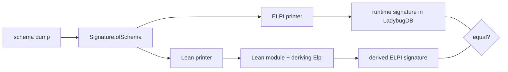

## ADDED Requirements

### Requirement: Schema dump
`CALL elpi_signature(format := 'json')` SHALL return the schema model the signature generator reads, as one JSON document: node tables with primary key and typed properties, rel tables with their FROM/TO pairs and typed properties, and annotations. `_elpi_*` tables SHALL be excluded. Keys SHALL be sorted and the document SHALL be byte-identical for equal schemas, whatever the order in which tables were created.

#### Scenario: Dump of a small schema
- **WHEN** the schema has `Person(id INT64 PK, name STRING)` and `ReportsTo(FROM Person TO Person, since INT64)` and `elpi_signature(format := 'json')` is called
- **THEN** the result lists `Person` with primary key `id` and properties `id`, `name`, and `ReportsTo` with one pair `Person → Person` and property `since`

#### Scenario: Dump is canonical
- **WHEN** the same schema is created twice with tables in different orders
- **THEN** both dumps are byte-identical

### Requirement: Lean inductives from the schema
`lake exe marien-codegen <dump.json> -o <Module.lean>` SHALL emit a Lean module containing, for each kind in the shallow signature, an `inductive` with `deriving Elpi`: one per node table (constructor from the primary key), one per reified edge kind, one per union endpoint kind and one per generated STRUCT record. The module SHALL build with Lean 4.35 and LeanElpi without Mathlib. The tool SHALL obtain the kinds and constructors from `Signature.ofSchema`, the same function the extension uses at run time, and SHALL NOT recompute the encoding.

#### Scenario: Generated module builds
- **WHEN** codegen runs on the dump of a schema with node, rel, multi-pair rel and STRUCT columns
- **THEN** `lake build` of the emitted module succeeds

#### Scenario: Derived ELPI types match the runtime kinds
- **WHEN** a rule from a stored module is loaded in Lean against the emitted module
- **THEN** it typechecks without edits

### Requirement: Offline and runtime signatures agree
For every schema, the ELPI signature declared by the emitted Lean module through `deriving Elpi` SHALL equal, kind for kind and constructor for constructor with the same argument types, the signature the extension generates at run time. The codegen tool SHALL check this after emitting, and SHALL exit non-zero and name the first difference when the signatures differ.

#### Scenario: Agreement on random schemas
- **WHEN** the property test generates random schemas over all supported property types
- **THEN** for each one, the derived ELPI signature of the emitted module equals the runtime signature

#### Scenario: Disagreement fails the tool
- **WHEN** the Lean printer is changed so that one constructor's argument order differs
- **THEN** `marien-codegen` exits non-zero and names the kind and constructor that differ
