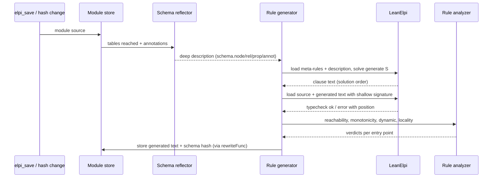

## Context

M1 to M3 give a typed shallow encoding ([[decisions#Predicate-per-property encoding]]), stored modules, typed entry points, validation, and an analysis that decides monotonicity, locality and scope. All of it assumes the clauses are known when a module is saved. M4 adds rules about the schema and combinators over relations without weakening any of that.

Two facts shape the design:

- **Clause type variables are rigid** ([[constraints#Clause type variables are rigid]]). `type schema.rel string -> (A -> E -> B -> prop) -> prop.` with clauses `schema.rel "Knows" knows.` and `schema.rel "PartOf" part_of.` fixes `A` differently in each clause, and LeanElpi rejects that. A reflected schema cannot carry predicate values.
- **The static checks need every clause.** Monotonicity ([[decisions#Closed-world scope]]) and locality ([[decisions#Partitioned validation]]) are judged over the clauses an entry point reaches. A clause that first appears during a run is a clause no check saw.

## Goals / Non-Goals

**Goals:** rules that quantify over the schema and its annotations; a combinator library that applies to every relation; generated code held to the same guarantees as hand-written code; generated code that can be inspected and reproduced.

**Non-Goals:** generating Lean code at run time (that is offline codegen, M5); reflecting data into stage 1; generating code from data during a run; a general macro system.

## Decisions

### Generation in two stages over a deep description

Stage 1 runs a module's meta-rules over a **deep** description of the schema in which tables, columns, types and annotations are plain data (`schema.rel "ReportsTo" "Person" "Person"`). Its output is **clause text** that names concrete shallow predicates (`reports_to`). Stage 2 parses that text, typechecks it against the shallow signature, runs the M3 analysis over it, and stores it.

This records [[decisions#Staged rule generation over a reflected schema]] ([[adr:0010]]).

- motivated_by:: [[constraints#Clause type variables are rigid]] {weight: primary}
- motivated_by:: [[decisions#Closed-world scope]]

**Rejected alternatives:**
- *One polymorphic `schema.rel` carrying predicate values.* LeanElpi's checker rejects it.
- *One `schema.rel_<sig>` per endpoint signature.* It typechecks, but a meta-rule can no longer range over all relations at once, and the number of predicates grows with the schema.
- *A universal `rel` kind with a generic `holds`.* It throws away the per-table types that M1 established.

### Reflected description from the schema model, minus system tables

The [[components#Schema reflector]] is a pure Lean function `Reflect.ofSchema : SchemaModel → Annotations → List Fact` over the same schema model the [[components#Signature generator]] reads. It filters `_elpi_*` tables before it emits anything and sorts its output by table, column and pair, so catalog order cannot leak into it.

- motivated_by:: [[decisions#Rules stored in system tables]]

### Annotations in a system table

Annotations live in `_elpi_annotation(table, key, value)` rather than in `COMMENT ON TABLE`. Comments are free text with no structure, and storing annotations next to the rules keeps both in the same backup and transaction ([[adr:0006]]). `elpi_annotate` writes through `rewriteFunc` ([[adr:0012]]). Annotations are part of the hash of every module that reaches the table, so the lazy recheck ([[adr:0011]]) regenerates the module's code.

- motivated_by:: [[constraints#Table functions can rewrite into Cypher]]
- motivated_by:: [[decisions#Lazy recheck by schema hash]]

### `dynamic` is inferred, never trusted

Using `=>` to add clauses for a database predicate during a run is the λProlog form of runtime generation. The [[components#Rule analyzer]] marks any entry point that reaches such a `=>` as `dynamic`. Dynamic entry points run at full scope only and are never partitioned. A user can mark more entry points dynamic, but can never mark one non-dynamic, because a wrong mark would bring back false answers.

- motivated_by:: [[decisions#Closed-world scope]] {weight: primary}
- motivated_by:: [[decisions#Partitioned validation]]

### `graph.std` as an ordinary ELPI module with locality metadata

The [[components#Graph standard library]] is source text shipped with the extension (`lib/graph/std.elpi`) and loaded like any module, so the analysis reads its real clauses. The locality metadata (radius 1 around the source node for the witness predicates) is declared in the library and **checked** by the analysis, not trusted. Where precomputed structural facts are loaded ([[components#Structural facts]]), `acyclic_witness` reads `in_cycle` and becomes local.

- motivated_by:: [[decisions#Predicate-per-property encoding]]
- motivated_by:: [[decisions#Partitioned validation]]

## Proofs and tests

Under [[decisions#Proofs where practical]] ([[adr:0020]]), each key property is either proved in Lean or tested, with the reason:

| Property | How | Why |
|---|---|---|
| Reflection names no `_elpi_*` table | **Proved**: `Reflect.ofSchema_no_system` | A filter over a finite list; the proof is short and rules out a whole class of self-reference bugs. |
| Reflection is independent of catalog order | **Proved**: `Reflect.ofSchema_perm` (permuted input gives equal output) | It follows from sorting. |
| Generated text depends only on (description, source) | **Proved**: `Stage.generate_deterministic` (`generate` is a pure function of its inputs, with no `IO` in its type) | Holds by construction; the lemma pins it so `IO` cannot slip in. |
| Every generated clause head is declared | **Proved**: `Stage.heads_declared` (well-scopedness of the clause emitter against `Signature.ofSchema`) | The emitter only builds heads from predicate names the signature defines. |
| Generated code passes the same checks as source | **By construction**: one code path loads `source ++ generated` | There is nothing separate to prove; a test confirms it. |
| `graph.std` combinators match their meaning | **Tested**: property tests against Lean reference implementations (`closure` against transitive closure over `Finset`, `acyclic_witness` against a cycle check, `card_witness` against counting) | λProlog semantics are not formalized in Lean, so a proof would need a model of the engine. Optional stretch: prove the Lean references correct. |
| `in_cycle` facts agree with search | **Tested**: differential test on random relations | It depends on LadybugDB's SCC implementation. |

## Constraints

- [[constraints#Clause type variables are rigid]]: binds the shape of the reflected description (monomorphic, plain data).
- [[constraints#Table functions can rewrite into Cypher]]: binds how `elpi_annotate` and `elpi_recheck` persist annotations and generated code.
- [[constraints#No DDL hooks for extensions]]: regeneration is lazy and keyed by hash, never pushed by a DDL event.

## Risks / Trade-offs

- **Stage 1 cost on hash changes.** A large meta-program regenerates on the first run after any change to a table it reaches. Mitigation: the handle cache keys on the generated text, and `elpi_recheck` can regenerate ahead of time.
- **Error messages point into generated text.** Errors cite positions in `generated`, and the stage 1 tracer records which meta-rule solution produced each clause.
- **Hidden blow-up.** A meta-rule can emit one clause per pair of tables. `elpi_max_facts` does not cover this, so stage 1 gets its own cap on the size of the generated text (`elpi_max_generated_bytes`).
