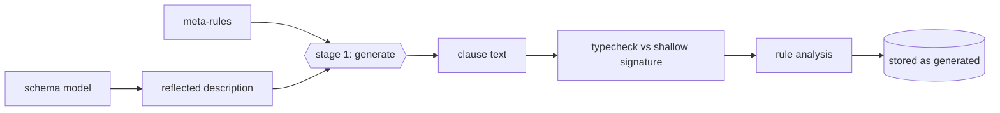

## ADDED Requirements

### Requirement: Stage one meta-rules
A module MAY declare meta-rules in a `meta` section that define `pred generate o:string.`. When the module is saved, and whenever its schema hash changes, the extension SHALL run `generate` over the reflected schema description (see schema-reflection, "Reflected schema description") together with the module's meta-rules, collect every solution in solution order, and concatenate them as the module's generated clause text. Stage 1 SHALL run under the same fuel and time limits as a run and SHALL see no database facts. If stage 1 fails, runs out of fuel or produces text that does not parse, the save SHALL fail (or the run SHALL fail, when regeneration was triggered by a hash change) with the error and the stage that produced it.

#### Scenario: Per-table clauses from an annotation
- **WHEN** a meta-rule emits `violation (cycle P) :- acyclic_witness <rel> P.` for every `schema.annot Name "acyclic" "true"` with `<rel>` the predicate name of `Name`, and `ReportsTo` and `PartOf` are annotated
- **THEN** the generated text contains one clause naming `reports_to` and one naming `part_of`, and no clause naming an unannotated table

#### Scenario: Stage one sees no data
- **WHEN** a meta-rule calls a generated database predicate such as `person.name`
- **THEN** the save fails with an error saying that database predicates are not available in stage 1

#### Scenario: Unparseable output fails the save
- **WHEN** `generate` yields the text `violation X :-`
- **THEN** the save fails with a parse error that points into the generated text and names the meta-rule stage

### Requirement: Generated code is checked like source
The generated clause text SHALL be loaded together with the module's hand-written clauses and SHALL pass the same type check against the shallow signature and the same rule analysis (reachability, monotonicity, `dynamic` inference, locality) as hand-written clauses. Every generated clause head SHALL name a predicate declared in the module or in the shallow signature. A generated clause that fails any check SHALL fail the save with an error that cites the position in the generated text.

#### Scenario: Ill-typed generated clause is rejected
- **WHEN** a meta-rule emits `violation (cycle P) :- reports_to P "x" Q.` where the middle argument of `reports_to` has kind `reports_to_e`
- **THEN** the save fails with a type error located in the generated text

#### Scenario: Generated negation affects narrowed scope
- **WHEN** generated code places a database predicate under `not` in an entry point that was monotone before generation
- **THEN** the entry point is no longer reported monotone, and a narrowed-scope call to it is rejected

### Requirement: Generated code depends only on schema and source
For a given module source and reflected schema description, stage 1 SHALL produce byte-identical generated text on every run, in every process, on every platform. Generated text SHALL NOT depend on the order of catalog entries, on handle-cache state, on database contents or on time.

#### Scenario: Regeneration is byte-identical
- **WHEN** a module is saved, the database is reopened, and `elpi_recheck()` regenerates the module without any schema change
- **THEN** the stored `generated` value is byte-identical to the first one

#### Scenario: Catalog order does not matter
- **WHEN** the same schema is created in two databases with tables created in different orders
- **THEN** the generated text for the same module is byte-identical in both

### Requirement: Inspectable generated code
The extension SHALL store generated text on the module row as `_elpi_module.generated` together with the schema hash it was generated for. A lazy regeneration triggered by a run SHALL update only the in-memory handle cache; `elpi_recheck()` SHALL persist the regenerated text. `elpi_export` SHALL NOT include generated text, because it is derived.

#### Scenario: Generated code is queryable
- **WHEN** module `org-rules` with meta-rules is saved
- **THEN** `MATCH (m:_elpi_module {name: 'org-rules'}) RETURN m.generated` returns the generated clause text

#### Scenario: Export omits derived code
- **WHEN** `org-rules` is exported and imported into an empty database with the same schema
- **THEN** the imported module regenerates identical `generated` text

### Requirement: Dynamic entry points
The rule analysis SHALL infer an entry point to be `dynamic` when any clause it reaches uses `=>` with a clause whose head is a database predicate of the shallow signature. A user MAY mark an entry point `dynamic` with a `dynamic <pred>.` declaration, and the extension SHALL ignore any attempt to mark an inferred-dynamic entry point as not dynamic. Dynamic entry points SHALL run at full scope only: a narrowed-scope or partitioned call to one SHALL fail with an error naming the clause that made it dynamic.

#### Scenario: Hypothetical database facts make an entry point dynamic
- **WHEN** entry point `what_if` reaches `(reports_to P E M => violation V)`
- **THEN** the analysis reports `what_if` as dynamic and cites that clause

#### Scenario: Dynamic entry points are never partitioned
- **WHEN** `elpi_validate` runs a module whose `violation` is dynamic and the module declares an anchor partition
- **THEN** the call fails with an error saying that dynamic entry points run at full scope only

#### Scenario: Local hypotheticals stay static
- **WHEN** an entry point uses `=>` only with clauses for predicates the module itself declares
- **THEN** the entry point is not dynamic
