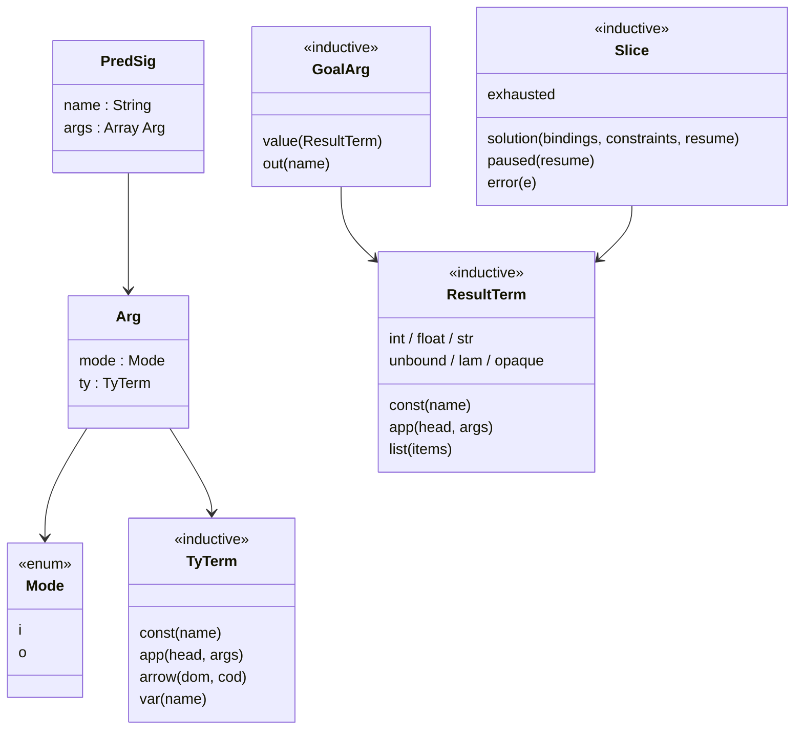
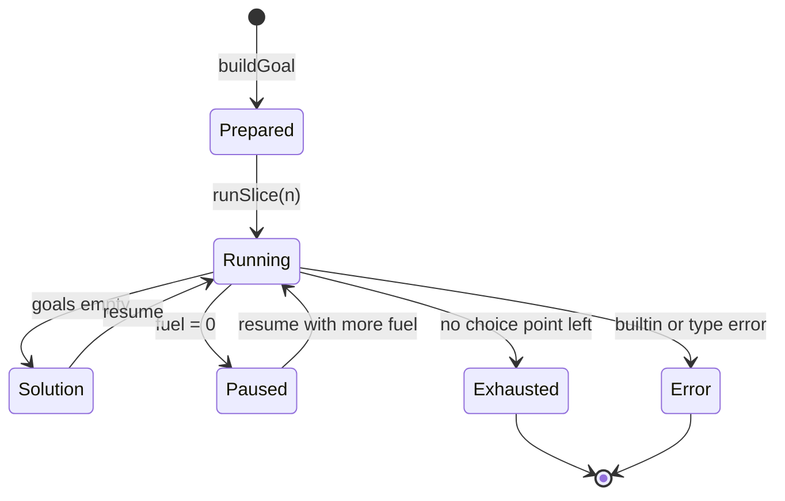

## Context

LeanElpi 0.3.3 has the parts Marien needs, but some are internal and some missing: `CompiledProgram.prepare` and `solveIO` take query text; the C interface prints bindings as text; `Step.outOfFuel` drops the machine ([[constraints#Out of fuel discards the search]]); declarations and clauses exist after type checking but aren't a supported API. Marien links LeanElpi statically and calls Lean directly ([[decisions#Logic in Lean behind a thin C++ shim]]), so the contract is a Lean API, not new C functions. LeanElpi's `leanelpi.h` stays as it is, apart from optionally adding the JSON form of structured terms.

## Goals / Non-Goals

**Goals:** a small, stable Lean surface (`Elpi.Host`) that Marien can depend on across LeanElpi releases, with each requirement covered by a contract test in Marien.

**Non-Goals:** reclaiming variables in long runs (Marien works around it with a fresh store per run or per batch, see [[constraints#LeanElpi memory grows in long runs]]); new language features; changes to answer order.

## Decisions

- **A host façade, `Elpi.Host`.** One module re-exports the stable types (`PredSig`, `Arg`, `Mode`, `TyTerm`, `GoalArg`, `ResultTerm`, `Slice`, `Ast.Program`) and functions. Marien imports only `Elpi.Host`, so engine internals can change. Rejected: depending on `Elpi.Core.*` directly, which ties Marien to the engine's internals.
- **Pause as a step result.** `Step` gains `paused (resume : Machine σ)`, returned when a slice's fuel hits zero. `outOfFuel` remains for callers that pass one budget. The pause is produced inside `runLoopS`, where the store is already a separate parameter, so the single-owner discipline of LeanElpi's "Persistent store" decision holds. Rejected: Marien driving `stepM` in its own loop, which would put the store's only owner outside the engine and risk silent array copies.
- **Goals from terms.** `buildGoal : CompiledProgram → (pred : String) → Array GoalArg → Except Error Prepared` creates fresh variables for outputs and type-checks the goal against `PredSig`. Input values never pass through the parser, which removes a whole class of injection bugs for `elpi_run` parameters. Rejected: quoting values into query text.
- **One result-term type, two encodings.** `ResultTerm` is the Lean value. `ResultTerm.toJson` and `fromJson?` serve the C interface and Marien's untyped `elpi_query`. Decoding into database values happens in Marien's [[components#Value codec]], not in LeanElpi.
- **Facts as terms, in batches.** `addFacts : CompiledProgram → (pred : String) → Array (Array ResultTerm) → Except Error CompiledProgram` checks each row against the predicate's signature once per batch and appends to the clause index in place when the program value is uniquely owned. Rejected: generating fact text for `leanelpi_assert`, which spends most of a materialization in the printer and the parser.
- **Named source units.** `loadUnits : List (String × String) → Except Error CompiledProgram`, with positions carried per unit. Marien prepends the generated signature as unit `signature` and reports errors in the module's own coordinates.

## Proofs and tests

Following [[decisions#Proofs where practical]]:

| Property | How | Why |
|---|---|---|
| `ResultTerm.fromJson? (toJson t) = some t` | **proved**: theorem `ResultTerm.json_roundtrip` in lean-elpi, by structural induction on `ResultTerm` | total over an inductive type; the C interface and `elpi_query` depend on it |
| `TyTerm` comparison is decidable and agrees with equality | **proved**: `deriving DecidableEq` plus `TyTerm.beq_iff_eq` | used to match signatures at bind time |
| Slices of any size equal one run | tested: property test over the bench programs and random slice sizes | `runLoopS` is `partial`, so a proof would need a fuel-indexed model of the machine; worth doing later, too large for 0.4 |
| Pausing keeps in-place updates | tested: `tests/Core/Scaling.lean` | a performance property, not a logical one |
| Goals built from terms are never parsed | tested: injection scenarios | the property concerns the absence of a code path |
| A batch either adds every fact or none | **proved**: theorem `addFacts_atomic`, since `addFacts` is a pure function returning `Except` and the input program is unchanged | total over the batch; the materializer relies on it |
| Fact loading is linear | tested: timing scenario | a performance property |

## Risks / Trade-offs

- **API freeze cost:** a public AST constrains future refactors of the engine. Mitigation: the AST is a separate view built from the internal form, versioned with LeanElpi's minor version.
- **Release coupling:** Marien M1 cannot start its typed work until 0.4 ships. M1's untyped path can begin with 0.3.3 plus text queries, then switch.
