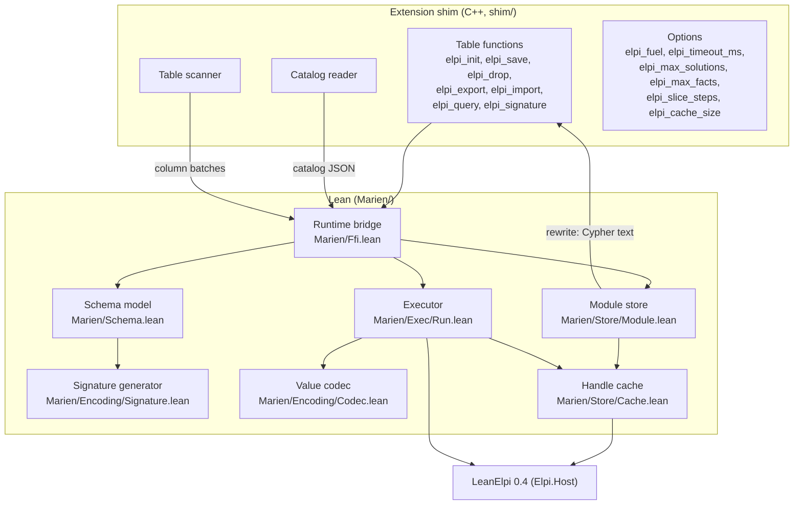
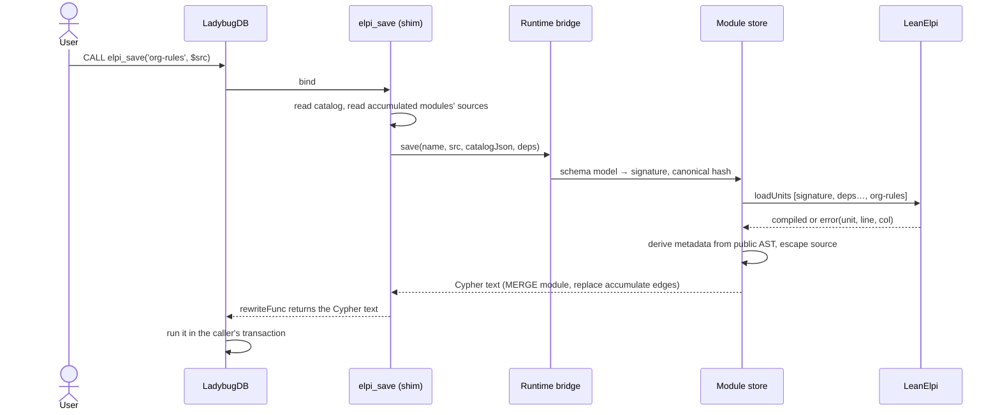
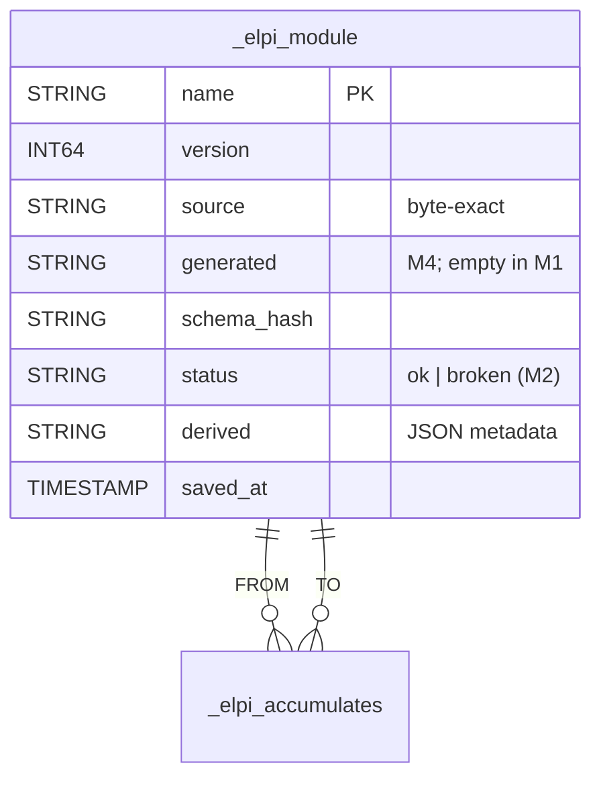

## Context

The spike leaves a build recipe and a runtime bridge; M0 leaves the LeanElpi 0.4 host API. M1 connects them through four layers: catalog → schema model → signature, module storage, materialization, and execution. The guiding decisions are [[decisions#Logic in Lean behind a thin C++ shim]] (C++ only implements LadybugDB interfaces and moves data), [[decisions#Materialize facts per call]] and [[decisions#CALL functions first]].

## Goals / Non-Goals

**Goals:** one query from Cypher to answers through every layer; the encoding as one pure Lean function; storage that preserves source exactly; execution that can be cancelled and never truncates silently.

**Non-Goals:** typed `elpi_run`, `elpi_validate` and lazy recheck (M2); reachability per entry point, monotonicity and partitioning (M3); meta-rules and annotations (M4). M1 loads every table a module calls anywhere, which is a coarse but safe version of M3's per-entry-point analysis.

## Architecture



### Saving a module



### Running a query

```mermaid
sequenceDiagram
    actor U as User
    participant F as elpi_query (shim)
    participant B as Runtime bridge
    participant C as Handle cache
    participant T as Table scanner
    participant X as Executor
    participant E as LeanElpi
    U->>F: CALL elpi_query('org-rules', 'violation P W')
    F->>B: prepare(module row, catalogJson)
    B->>C: lookup (name, version, schemaHash)
    C-->>B: compiled program (or compile and insert)
    B-->>F: tables to load (from derived metadata)
    loop each table, in column batches
        F->>T: scan in the calling transaction
        T->>B: batch
        B->>X: codec → addFacts (checks elpi_max_facts)
    end
    X->>E: parse goal, runSlice(elpi_slice_steps)
    loop until exhausted, limit or error
        E-->>X: solution / paused
        X->>F: rows; F checks interrupt and deadline
    end
    F-->>U: rows (sol, var, value, exhausted)
```

### System tables



## Decisions

- **The catalog crosses the boundary as JSON; data crosses as column batches.** The catalog is small and read once per bind, so JSON keeps the C++ side trivial and lets the offline tool (M5) feed the same model from a file. Rows are many, so the scanner passes typed column vectors, which the codec turns into terms. Rejected: per-row calls into Lean, which pay the FFI cost millions of times.
- **Scan in the calling transaction** ([[decisions#Scan tables in the calling transaction]]). The table function reads node and rel tables through LadybugDB's storage interface with the caller's transaction. Rejected: issuing `MATCH` queries from inside the function, which re-enters the database ([[decisions#Materialize facts per call]]).
- **Naming is snake case with a collision check.** Readable identifiers (`reports_to`) matter in hand-written rules. Collisions are rare and are reported, never resolved silently. Rejected: an always-injective escape scheme (`g.Reports$To`), which makes every rule ugly to remove a rare failure. Aliases arrive with annotations in M4.
- **Edge ids are internal ids.** Rel tables have no primary key, so the edge term wraps LadybugDB's internal rel id. Results report endpoints by primary key. Edge ids are stable only within one transaction, which is enough for a read-only run ([[decisions#Read-only runs]]).
- **`elpi_init()` creates the tables explicitly.** An extension that runs DDL during `LOAD` surprises users and may not be possible in a read-only connection. Rejected: creating tables lazily on the first save.
- **Writes are one rewritten statement.** `elpi_save`, `elpi_drop` and `elpi_import` do all checking in bind and return a single Cypher statement through `rewriteFunc` ([[constraints#Table functions can rewrite into Cypher]]), so a save is atomic with the caller's transaction. If `rewriteFunc` cannot return several clauses in one statement (MERGE plus edge replacement), the first task finds out and the design falls back to one `UNWIND`-driven statement.
- **Source is escaped, not encoded.** Base64 would make `source` unreadable to Cypher users. Escaping keeps it readable and is proved correct (below).
- **One cache key, three parts.** `(name, version, schemaHash)`. In M1 the hash covers the whole schema. M2 narrows it to the tables a module reaches ([[decisions#Lazy recheck by schema hash]]).

## Proofs and tests

Following [[decisions#Proofs where practical]]:

| Property | How | Why |
|---|---|---|
| Naming is injective whenever generation succeeds | **proved**: `assignNames_injective : assignNames s = .ok m → Function.Injective m` | total over the finite name set; the reason the collision check exists |
| `_elpi_*` tables never reach the signature | **proved**: `signature_excludes_system : t ∈ (signatureOf s).tables → ¬ t.name.startsWith "_elpi_"` | a one-line filter, and a security property |
| Canonical hash ignores catalog order | **proved**: `canonical_perm : l₁ ~ l₂ → canonical l₁ = canonical l₂` (sorting a permutation) | total over lists |
| Value codec round-trip | **proved**: `Codec.decode_encode : v.HasType ty → decode ty (encode ty v) = some v`, by induction on `ty` (covers LIST and STRUCT) | total over an inductive type of values |
| Escaping round-trip and containment | **proved**: `unescape_escape : unescape (escape s) = s` and `escape_no_delim : ¬ hasBareDelimiter (escape s)`, over a model of Cypher string-literal lexing | the injection guarantee rests on it |
| Model of Cypher literal lexing matches LadybugDB | tested: hostile-character scenarios through real `elpi_save` and export | the proof is only as good as the model |
| Slicing does not change answers | tested: scenario with two slice sizes | relies on the engine's tested property (M0) |
| Cancellation, limits, memory release | tested: integration scenarios | behaviour of the host, not of Lean data |

## Risks / Trade-offs

- **Storage API access from a table function:** reading tables directly ties the scanner to LadybugDB internals that change between versions. Mitigation: pin the version ([[decisions#Out-of-tree extension with its own repository]]) and isolate the scanner behind one C++ interface.
- **Coarse materialization:** loading every table a module calls anywhere can be far more than one entry point needs. M3 replaces it with reachability per entry point. Until then, `elpi_max_facts` keeps it safe.
- **Integer range:** LadybugDB has UINT64 and INT128. Values outside the engine's `int` fail loudly rather than wrap. INT128 is not mapped.
