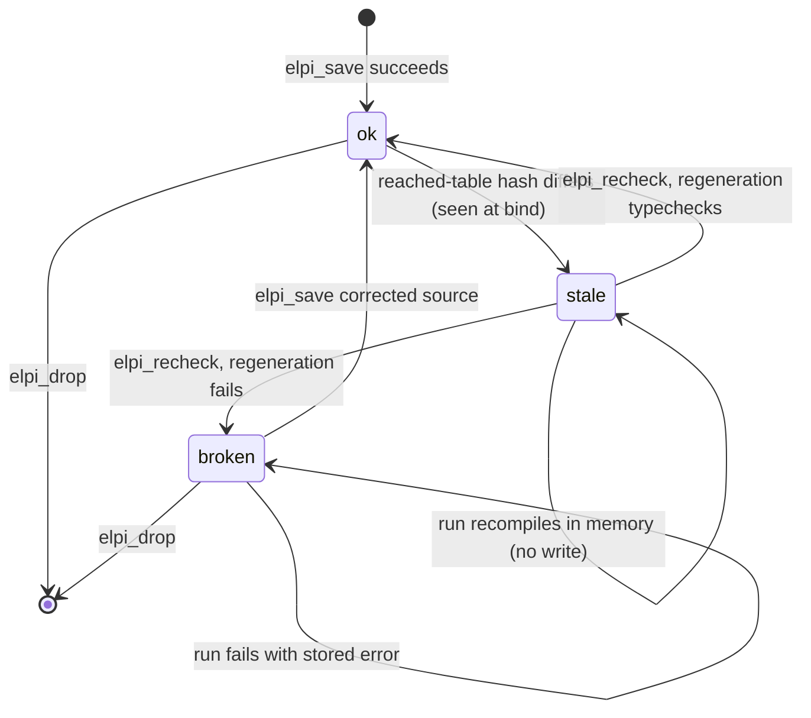
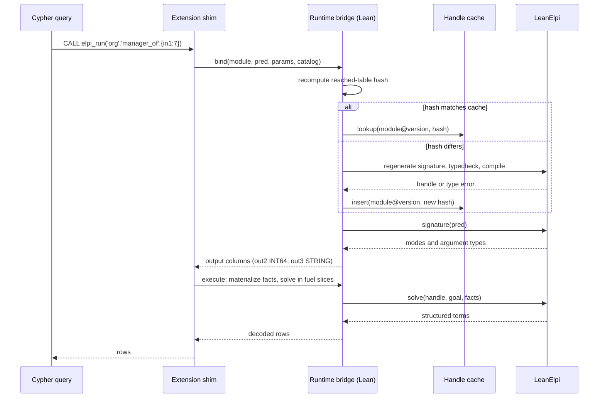

## Context

M1 proves the stack end to end with `elpi_query`, which returns strings. LadybugDB fixes a table function's output columns at bind time ([[constraints#Output columns are fixed at bind time]]), offers no DDL hooks ([[constraints#No DDL hooks for extensions]]), and loads only extensions built against its exact version ([[constraints#Extensions are C++ shared libraries]]). M0 gives the Lean side entry-point signatures and structured result terms. This change builds the typed path, the validation protocol, schema-change safety and distribution on top of those.

## Goals / Non-Goals

**Goals:** typed `elpi_run`; `violation` and `elpi_validate` with one report shape; correct behaviour after any DDL; an install path through `INSTALL … FROM`.

**Non-Goals:** narrowed scope and partitioning (M3); schema annotations and generated rules (M4); eager rechecks through an upstream DDL hook; custom statements.

## Decisions

### Typed entry points from the engine signature
`elpi_run` binds in three steps: look up the compiled module in the [[components#Handle cache]] (recompiling if the hash moved, see below), ask the engine host API for the predicate's modes and argument types, and map each `o:` type to a column through the [[components#Value codec]]. Rows are decoded from structured result terms.
- Records [[decisions#Typed entry points and an untyped debug query]] ([[adr:0008]]); motivated by [[constraints#Output columns are fixed at bind time]].
- Rejected: inferring columns from a free-form goal (needs type inference of query variables at bind time, which the host API does not offer); decoding printed terms (ties correctness to the pretty-printer).

### Subject as a generated union kind
`subject` has one constructor per table, generated by the [[components#Signature generator]] with the same names as the schema encoding. Violations stay typed in rules (`subj_person P` cannot carry a `dept`) and become the uniform pair (label, key) at the boundary.
- Records [[decisions#Validation protocol]] ([[adr:0015]]).
- Rejected: `subject` as a string (loses typing in rules); one `violation_<table>` predicate per table (no single entry point).

### Hash only what a module reaches
The [[components#Module store]] keeps, per module, a hash over the canonical catalog entries of the tables its clauses mention through `accumulate`. Reachability here is syntactic (which generated predicates appear); M3's [[components#Rule analyzer]] refines it per entry point but never widens the module-level set.
- Records [[decisions#Lazy recheck by schema hash]] ([[adr:0011]]); motivated by [[constraints#No DDL hooks for extensions]].
- Rejected: a whole-catalog hash (every `CREATE TABLE` invalidates every module).

### Recompile in memory during runs, persist only in `elpi_recheck`
A run never writes: a stale module is recompiled into the handle cache keyed by the new hash. Only `elpi_recheck` writes, through `rewriteFunc`, in one statement.
- Motivated by [[constraints#Table functions can rewrite into Cypher]] and [[decisions#Read-only runs]] ([[adr:0007]]).
- Rejected: falling back to the last good compilation (runs stale code against a changed schema); writing from inside a run (a `CALL` in a read query cannot write).

### Out-of-tree build, one pinned version
A Lake static archive plus a CMake-built shim, linked into one library with hidden visibility; the pinned LadybugDB version lives in one file read by build and load check.
- Records [[decisions#Out-of-tree extension with its own repository]] ([[adr:0017]]); motivated by [[constraints#Extensions are C++ shared libraries]] and [[constraints#One Lean runtime per process]].
- Rejected: contributing to `ladybugdb/extensions` now (upstream CI has no Lean toolchain).

## Diagrams

Module status as seen by runs and by `elpi_recheck`:

Binding and running `elpi_run`:

## Proofs and tests

Per [[decisions#Proofs where practical]] ([[adr:0020]]):

| Property | How | Why |
|---|---|---|
| Schema hash depends only on reached tables and is order-independent | proved: `Marien.Schema.hash_restrict` (hash of a catalog equals hash of its restriction to the reached set) and `Marien.Schema.hash_perm` | total statement over finite catalog data |
| Subject codec round-trips | proved: `Marien.Codec.subject_decode_encode` and `Marien.Codec.subject_encode_decode` (on terms in the image) | structural over the generated constructors |
| Value codec round-trips for every column type with a mapping | proved: `Marien.Codec.value_roundtrip` | structural over the codec's type map |
| Severity filter keeps exactly rows at or above the threshold | proved: `Marien.Validate.filter_sound` | decidable order on three values |
| Recheck is atomic | tested: integration test with rollback | depends on LadybugDB transactions |
| Runs never fall back to stale code | tested: drop a reached table between runs | crosses the C++ boundary |

## Risks / Trade-offs

- [Risk] `rewriteFunc` may not be able to bind parameters, so generated signature text is embedded in Cypher. → Reuse M1's escaping and its save/export byte round-trip test.
- [Risk] Recomputing the hash on every bind costs a catalog read. → The catalog is in memory; the hash covers only reached tables; measure in the tracer benchmark.
- [Trade-off] Full scope only in this milestone, so validation is limited to graphs that fit `elpi_max_facts`. M3 lifts this.
- [Risk] Extension server layout follows LadybugDB's undocumented `INSTALL … FROM` conventions. → Pin to the version's source and test install in CI.
