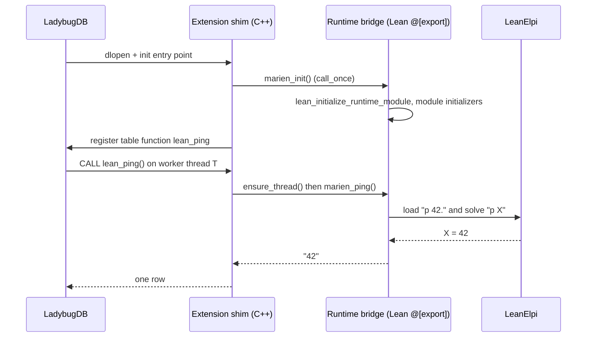
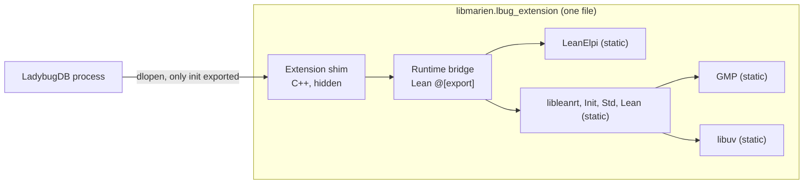

## Context

LadybugDB loads an extension with `dlopen` and calls its init entry point, which registers functions in the catalog. Function bodies then run on LadybugDB worker threads that Lean never created. LeanElpi's `scripts/build-ffi.sh` already shows how to link the engine, the Lean runtime libraries, GMP and libuv into one self-contained library on macOS. On Linux the toolchain's archives could not be linked into a shared object, and `libleanshared` was shipped next to the library instead. That is a second Lean runtime library, so on Linux the spike has to find a fully static route. See [[constraints#One Lean runtime per process]].

## Goals / Non-Goals

**Goals:** prove that one Lean runtime can live inside LadybugDB, be called from worker threads, coexist with other extensions and fit a reasonable size. Leave a build recipe M1 can reuse.

**Non-Goals:** schema encoding, rule storage, real functions. The spike code is thrown away. Only its build script, its symbol checks and its requirements carry over.

## Decisions

- **Static link into one library.** The extension library contains everything Lean-related. This rules out linking the published `libleanelpi`, which would add a second runtime as soon as Marien's own Lean code is also present. Rejected: two libraries with a shared `libleanshared`, which needs both to be built by the same toolchain and installed side by side, and fights [[decisions#Out-of-tree extension with its own repository]]. Motivated by [[constraints#One Lean runtime per process]].
- **Init through `@[export]` and a C entry.** The C++ init calls a C function generated by Lean (`marien_init`), which runs `lean_initialize_runtime_module` and the module initializers once, guarded by `std::call_once`. Rejected: initializing lazily on the first call, which would move start-up time (about a second for LeanElpi) and its failures into a user's query.
- **Thread registration copied from LeanElpi.** A `thread_local` flag and `lean_initialize_thread()` on first entry, as in LeanElpi's `ffi/leanelpi.c`. Threads are never finalized, because LadybugDB's pool threads live as long as the process.
- **Hidden visibility plus an export list.** `-fvisibility=hidden` for the shim and an exported-symbols list (`-exported_symbols_list` on macOS, a version script on Linux) that names only the loader entry points. Rejected: relying on default visibility, under which a second extension with its own libuv could bind to Marien's.

## Proofs and tests

| Property | How | Why |
|---|---|---|
| One runtime, no Lean shared dependency | tested: dependency listing in CI | a property of the link, outside Lean |
| Thread registration is idempotent per thread | tested: concurrency stress | depends on the C runtime and LadybugDB's thread pool |
| Only loader entry points exported | tested: symbol listing in CI | a property of the binary |

Nothing in the spike is a total statement over Lean data, so nothing here is proved ([[decisions#Proofs where practical]]).

## Risks / Trade-offs

- **Linux static linking may not work** with the stock Lean toolchain archives (see LeanElpi's Linux notes). Mitigation: try `-Wl,--whole-archive` with `-fPIC` toolchain archives, then a custom Lean build with PIC archives. Recording no-go on Linux is an acceptable outcome that changes the distribution plan.
- **LadybugDB may expect a fixed entry symbol name** or a C++ ABI-specific signature. The spike reads the loader in `src/extension/extension_loader.cpp` and records the exact contract.
- **Start-up cost:** module initialization runs at `LOAD`. Measure it; above two seconds, a follow-up to trim imported Lean modules is needed.
