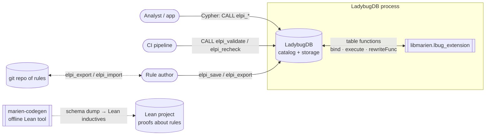
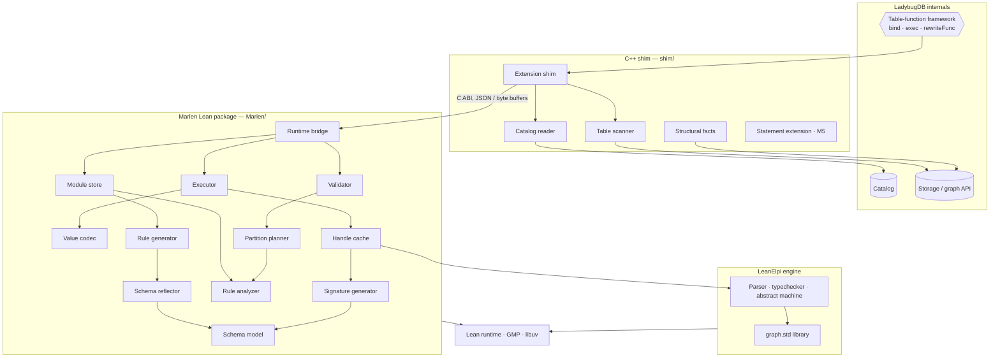
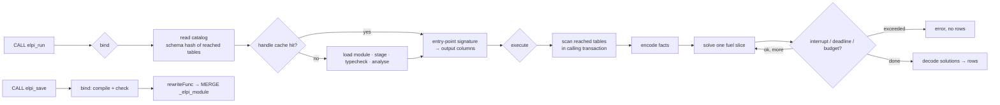
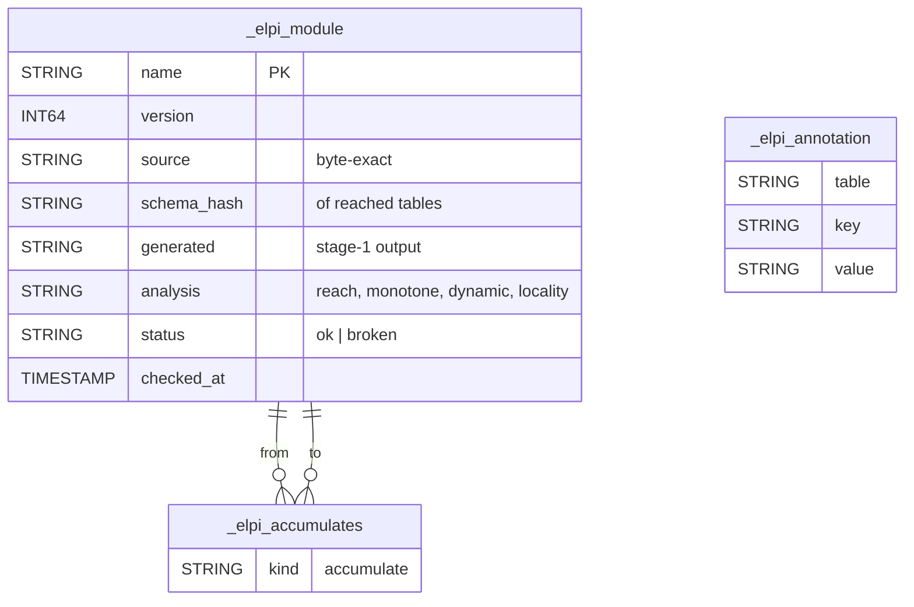
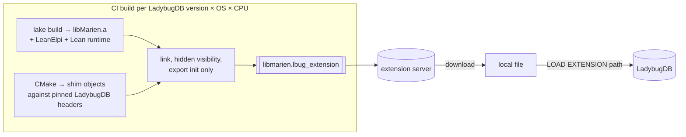

# Architecture

How Marien is put together: the system context, the layers inside the one shared library, how a call flows through them, and how it ships. Components are in [[components]], detailed UML in [[uml]].

- [[components]] — one section per module or tool, with dependencies, motivating decisions and the introducing change
- [[uml]] — data model, save, run and partitioned-validation sequences, module status and analysis pipeline

Marien is one LadybugDB extension library. A thin C++ shim speaks LadybugDB's table-function interfaces; everything with meaning — encoding, staging, analysis, execution, decoding — is Lean in the `Marien` package, linked statically with LeanElpi and the Lean runtime ([[decisions#Logic in Lean behind a thin C++ shim]]).

## System context

Users and CI talk Cypher to LadybugDB; LadybugDB loads Marien and calls its table functions; Marien never talks to anything outside the database process.

- illustrates:: [[decisions#CALL functions first]]
- illustrates:: [[decisions#Schema types at runtime and Lean inductives offline]]

## Layers

Four layers inside one library: the C++ shim, the Marien Lean package, the LeanElpi engine and the Lean runtime; only the shim touches LadybugDB internals, only Marien calls LeanElpi.

The C ABI between shim and Lean carries only handles, UTF-8 strings and flat byte buffers of facts and rows, as LeanElpi's own C API does; no Lean object crosses into C++.

- illustrates:: [[decisions#Logic in Lean behind a thin C++ shim]]
- illustrates:: [[constraints#One Lean runtime per process]]

## Call lifecycle

Every function call follows LadybugDB's two phases: bind (fix output columns, compile or fetch the program) and execute (scan, encode, solve in fuel slices, decode); writes go through `rewriteFunc`.

- illustrates:: [[decisions#Materialize facts per call]]
- illustrates:: [[decisions#Scan tables in the calling transaction]]
- illustrates:: [[decisions#Fuel-sliced execution that fails loudly]]

## Data model in the database

Marien keeps its state in three system tables, which the generated signature never exposes to rules.

- illustrates:: [[decisions#Rules stored in system tables]]

## Correctness guards

Each guarantee about answers has one guard that enforces it and one test or proof that checks the guard.

| Guarantee | Guard | Checked by |
|---|---|---|
| Negation sees all facts | full scope unless proved monotone | narrowing subset property |
| Partitions do not change answers | locality check, subject = anchor | partition equivalence property; coverage theorem |
| Generated code is checked | staging before typecheck and analysis | determinism theorem |
| No truncated results | budgets are errors | e2e tests |
| Rules match the schema | lazy recheck by schema hash | hash locality theorem |
| Encoding is faithful | codec | round-trip theorems |

- illustrates:: [[decisions#Closed-world scope]]
- illustrates:: [[decisions#Partitioned validation]]
- illustrates:: [[decisions#Proofs where practical]]

## Deployment

One file, `libmarien.lbug_extension`, built per LadybugDB version, OS and CPU, served from Marien's own extension server, downloaded and loaded with `LOAD EXTENSION '<path>'` (`INSTALL marien FROM <url>` once LadybugDB accepts third-party names).

- illustrates:: [[decisions#Out-of-tree extension with its own repository]]
- illustrates:: [[constraints#Extensions are C++ shared libraries]]
