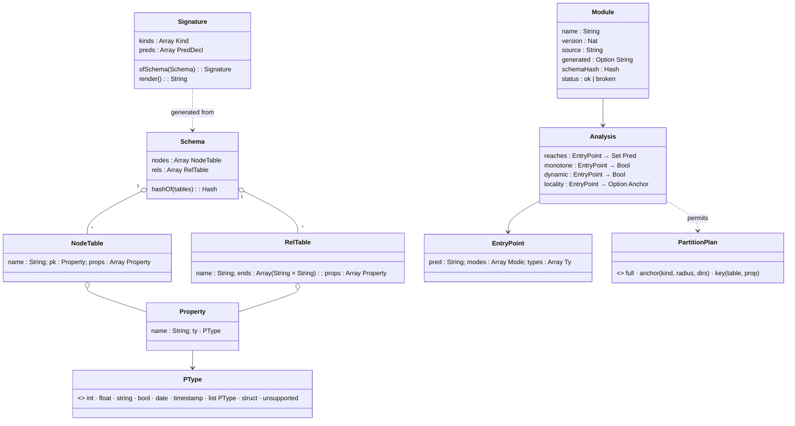
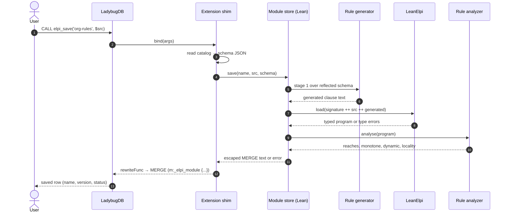
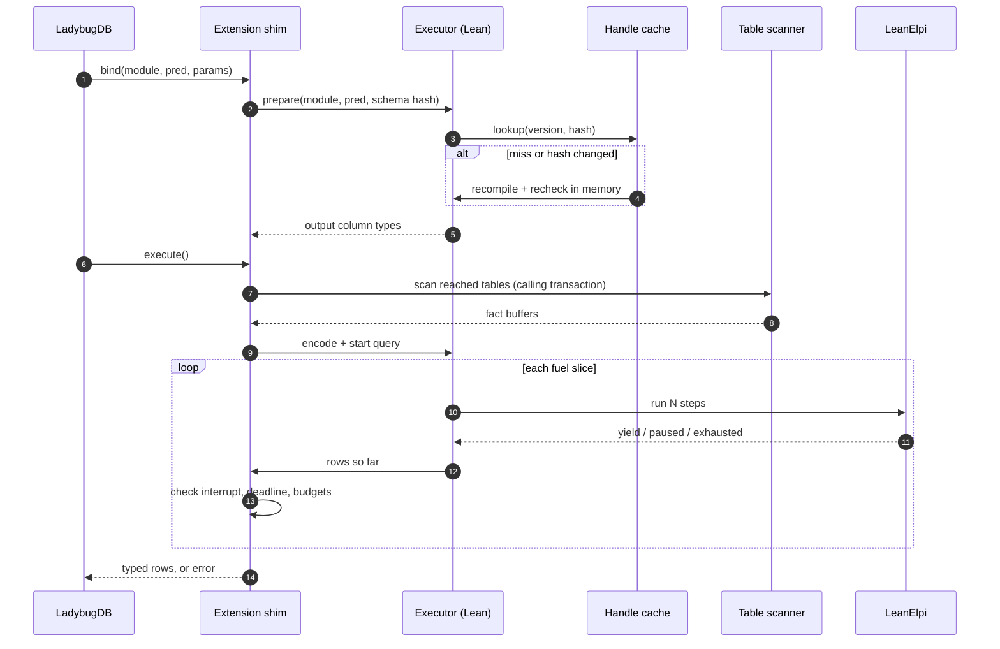
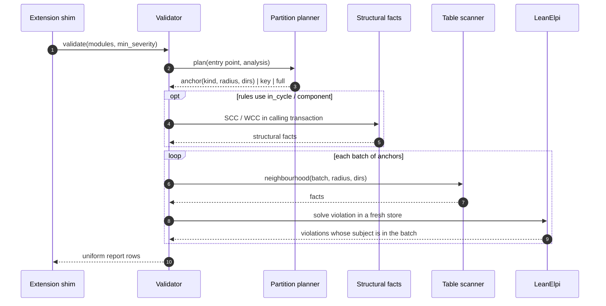
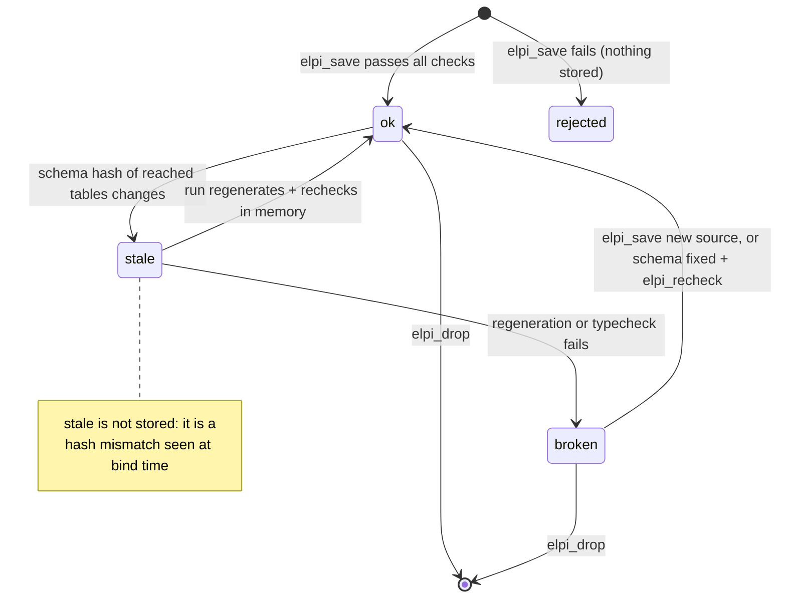
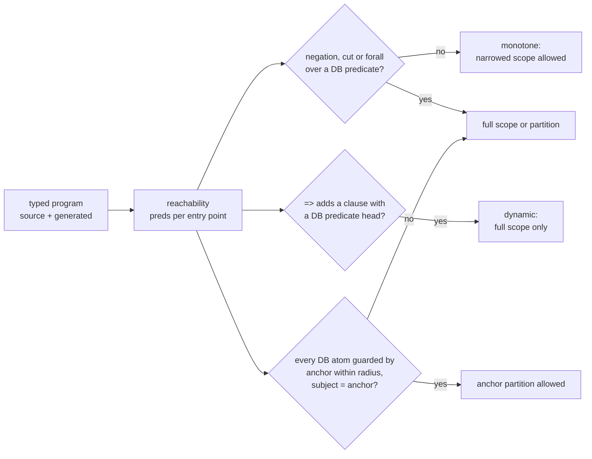

# UML

Class, sequence and state diagrams for Marien's main flows; the layer view is in [[architecture#Layers]] and the modules in [[components]].

## Lean data model

The core Lean types: the schema read from the catalog, the signature generated from it, stored modules with their analysis, and partition plans.

- illustrates:: [[decisions#Predicate-per-property encoding]]
- illustrates:: [[decisions#Closed-world scope]]

## Save sequence

`elpi_save` compiles and checks everything in bind, then rewrites itself into a `MERGE` that stores the module; a module that fails any check is never stored.

- illustrates:: [[decisions#CALL functions first]]
- illustrates:: [[decisions#Staged rule generation over a reflected schema]]

## Run sequence

`elpi_run` fixes typed columns in bind, then scans, solves in fuel slices and decodes in execute; an exceeded budget is an error with no rows.

- illustrates:: [[decisions#Typed entry points and an untyped debug query]]
- illustrates:: [[decisions#Fuel-sliced execution that fails loudly]]

## Partitioned validation sequence

`elpi_validate` on a large graph plans partitions from the analysis, computes structural facts once, then solves anchor batches in fresh stores and concatenates the reports.

- illustrates:: [[decisions#Partitioned validation]]
- illustrates:: [[decisions#Validation protocol]]

## Module status

A stored module is `ok` or `broken`; a schema change makes it stale, which a run resolves in memory and `elpi_recheck` persists.

- illustrates:: [[decisions#Lazy recheck by schema hash]]
- illustrates:: [[constraints#No DDL hooks for extensions]]

## Analysis pipeline

The rule analyzer turns a typed program into per-entry-point verdicts that decide which scopes and partitions a call may use.

- illustrates:: [[decisions#Closed-world scope]]
- illustrates:: [[decisions#Partitioned validation]]
